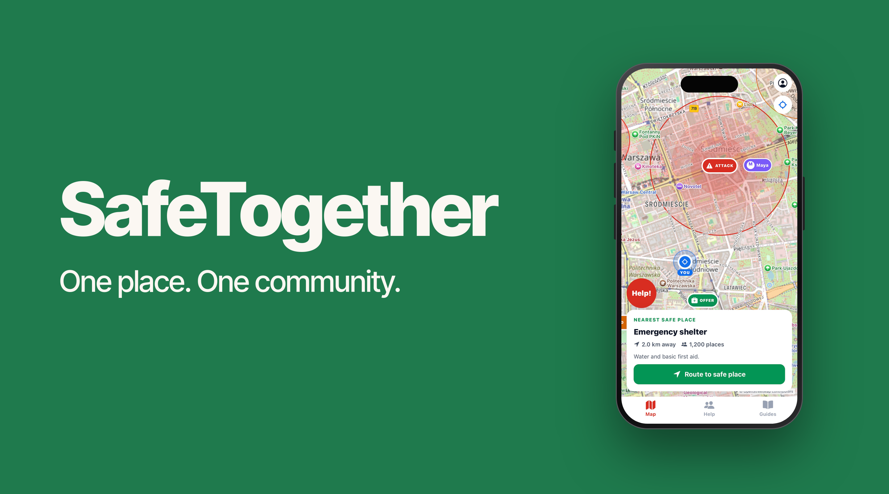

<div align="center">

# SafeTogether

### Calm guidance when every second matters.

A mobile-first emergency map that helps people understand nearby risks, find support, and choose safer routes.

<br />

[](https://expo.dev/)
[](https://reactnative.dev/)
[](https://www.openstreetmap.org/)
[](https://www.typescriptlang.org/)

</div>



---

## The problem

In a crisis, a normal map is often the wrong tool. It is full of restaurants, shops and everyday navigation details, while people need immediate answers:

> **Where is the danger? Where can I go? Who can help? Which route is safer?**

SafeTogether turns the map into a focused emergency interface. It reduces noise and prioritises information that matters under stress.

## What SafeTogether does

SafeTogether is a mobile-first safety application for people in potentially dangerous areas. It helps users understand nearby threats, locate shelters and first-aid points, see people nearby, access community help offers, and choose safer road routes.

The product is designed to feel calm, clear and usable in high-pressure situations.

## Core features

| Feature | Description |
| --- | --- |
| **Emergency map** | OpenStreetMap-powered map designed for emergency use rather than everyday navigation. |
| **Hazard zones** | Clear labelled danger areas for fire, military attacks and civil unrest. |
| **Risk areas** | Layered visual zones that make the approximate extent and severity of a hazard easy to understand. |
| **Emergency locations** | Shelters, safe zones and first-aid points shown directly on the map. |
| **Current location** | Permission-based device location with a highly visible `YOU` marker. |
| **Nearby people** | Selected nearby contacts shown without overwhelming the map. |
| **Help offers** | Community support offers, such as water or shelter, shown as map points. |
| **Safe routing** | Road-based route calculation that attempts to avoid active danger areas. |
| **Custom destinations** | Long-press any map location to set a destination and calculate a route. |
| **Help reporting** | Users can send help requests and report incidents. |
| **Connectivity awareness** | The interface handles unavailable network conditions and falls back to demonstration data where appropriate. |

## Safety-first design

> **In an emergency, less interface means faster decisions.**

SafeTogether deliberately avoids irrelevant points of interest and prioritises danger, safe destinations, access to help, high-contrast visual hierarchy and simple actions.

```text
Current location
      ↓
Visible hazards and emergency locations
      ↓
Tap a safe point or long-press a destination
      ↓
Calculate a road-based route
      ↓
Avoid active danger zones where possible
```

## Technology stack

### Mobile and web

- TypeScript
- React 19
- React Native
- Expo 58
- Expo Router
- React Native Web
- React Native Reanimated
- React Native Safe Area Context and Screens
- React Native SVG and Expo Vector Icons

### Maps and routing partner tools

- **OpenStreetMap** — open geographic data and map tiles.
- **React Native Maps** — native mobile map rendering.
- **Leaflet + React Leaflet** — web map rendering.
- **OSRM** — road-based route calculation between the user and a selected destination.

### Expo capabilities

- **Expo Location** — foreground device-location access.
- **Expo Network** — connectivity awareness.
- **Expo Secure Store** — secure native session-token storage.
- **Expo Image Picker** — image selection for incident reports.
- **Expo File System** — local file support.
- **Expo Linking** — deep-link support.
- **Expo Haptics**, **Expo Font** and **Expo Status Bar** — mobile presentation and interaction.

### Backend and persistent data

- Node.js HTTP API with REST-style JSON endpoints.
- Native Node.js `http`, `crypto` and file-system modules.
- Persistent file-based JSON data store (`store.json`).
- Signed bearer-token authentication, HMAC signatures, password hashing with `scrypt`, UUIDs and timing-safe comparisons.
- Audit records for important backend actions.

The persistent store contains users, sessions, incidents, help offers, help requests, messages, notices, emergency sites, danger zones, locations, connections and audit records.

### Collaboration and quality

- **GitHub** — source control, branches, pull requests and collaboration.
- **TypeScript** — static type checking.
- **ESLint / Expo lint** — code-quality checks.
- **Expo CLI** — development and Android export validation.

## Project structure

```text
SafeTogether/
├── mobile/                 # Expo / React Native application
│   ├── src/app/            # Screens and navigation
│   ├── src/components/     # Map, UI and reusable components
│   ├── src/services/       # API, routing and offline helpers
│   ├── src/shared/         # Models, demo data and map helpers
│   └── src/state/          # Application state
├── backend/                # Node.js API
│   └── src/server.js       # API, auth and persistent data store
└── README.md
```

## Getting started

### Start the backend

```bash
cd backend
node src/server.js
```

The API runs on port `8787` by default.

### Configure the mobile app

Create `mobile/.env.local`:

```env
EXPO_PUBLIC_API_URL=http://YOUR_LOCAL_IP:8787/v1
```

When testing on a physical phone, use your computer's local-network IP address rather than `localhost`.

### Run the app

```bash
cd mobile
npm install
npx expo start
```

To launch Android:

```bash
npx expo start --android
```

## Validation

The project was validated with:

```bash
npx tsc --noEmit
npx expo lint
npx expo export --platform android
```

We also manually tested current-location permission and display, hazard visibility, emergency-site selection, showing and hiding point details, long-press destination selection, automatic route calculation, route dismissal and API fallback behaviour.

## Important prototype notice

SafeTogether is a hackathon prototype. Some hazards, people, help offers, shelters and other map entries are demonstration data. The application is not a substitute for official emergency services or verified public-safety instructions.

Always follow directions from local authorities and contact emergency services when immediate help is needed.

## What comes next?

- Verified authority and official-alert integrations
- Community-report moderation and confidence scoring
- Offline map packs and cached emergency guidance
- Offline routing and real-time road closures
- Family groups and consent-based location sharing
- Multilingual accessibility support
- Managed database and object storage
- Security, privacy, legal and emergency-service review

---

<div align="center">

Built for safer decisions in difficult moments.

**SafeTogether — clear information, safer choices.**

</div>
